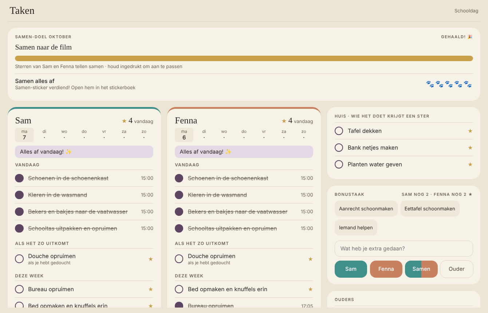

# Takenlijst voor kinderen (Home Assistant)



Een takenscherm voor de tablet:

- **Kinderen vinken hun eigen taken af** en verdienen sterren.
- **Huistaken zijn voor wie ze doet.** Bij het afvinken kies je wie het deed: een kind, Samen of Ouder.
- **Bonustaken** geven extra sterren, met een maximum per dag.
- **Samen-doel per maand:** de sterren van alle kinderen tellen samen op naar een beloning.
- **Stickerboek met envelopjes.** Elke N sterren levert een envelopje op met een willekeurige sticker; daar zitten ook zeldzame en gouden tussen. Hebben alle kinderen 5 dagen alles af gehad, dan volgt een samen-sticker.

Alles draait lokaal: een Python-script schrijft JSON-bestanden in `/config/taken/` en een `command_line`-sensor leest ze uit. Er zijn geen integraties uit HACS nodig.

## Downloaden

Klik op **Code → Download ZIP**, of gebruik `git clone`. Wil je later updates binnenhalen? Kopieer dan bij een nieuwe versie alleen `taken.py`, de package en de twee kaarten. Je eigen `taken.json` blijft zo staan.

## Inhoud

```
taken/taken.py              script (afvinken, sterren, envelopjes, status)
taken/taken.json            jouw kinderen, taken en instellingen  ← aanpassen
taken/albums/herfstpup.json stickeralbum (31 stickers)
taken/albums/samen.json     samen-stickers (6)
packages/taken.yaml         sensor, shell_command, scripts, automatiseringen
www/taken-card.js           de kaart
www/stickerboek-card.js     stickerboek (ook los te gebruiken op de tablet van een kind)
www/stickers/…              de stickerplaatjes
```

## Installeren

1. **Kopieer de mappen naar `/config`.**
   - `taken/` → `/config/taken/`
   - `packages/taken.yaml` → je packages-map (vereist `homeassistant: packages: !include_dir_named packages`)
   - `www/*` → `/config/www/`
2. **Pas `/config/taken/taken.json` aan.** Zet je eigen kinderen bij `personen`, met de schrijfwijze die je op het scherm wilt zien, en zet je eigen taken bij `taken`. Uitleg staat hieronder.
3. **Herstart Home Assistant volledig.** YAML herladen is niet genoeg voor `shell_command` en `command_line`. Na de herstart maakt de automatisering *Takenlijst verversen* `status.json` aan, en `sensor.taken_status` vult zich binnen een minuut.
4. **Voeg de twee bronnen toe** onder Instellingen → Dashboards → ⋮ → Bronnen, beide als *JavaScript-module*:
   - `/local/taken-card.js?v=1`
   - `/local/stickerboek-card.js?v=3`
5. **Maak een view van het type Paneel** met:
   ```yaml
   type: custom:taken-card
   ```
   Een paneel-view werkt het mooist, omdat de kaart dan het hele scherm vult. In een gewone view gebruik je `volledig_scherm: false`.

**Optioneel: een eigen tablet per kind.** Zet daar alleen het stickerboek van dat kind op:

```yaml
type: custom:stickerboek-card
persoon: Sam
```

## Opties van de kaart

| optie | standaard | |
|---|---|---|
| `kleuren` | palet | per kind, bijvoorbeeld `{ Sam: '#3f8f8a', Fenna: '#c9805f' }` |
| `thema` | `auto` | `auto` volgt het donkere thema van HA; verder `licht` of `donker` |
| `volledig_scherm` | `true` | `false` geeft een gewone kaarthoogte |
| `ouder_tonen` | `true` | de kaart *Ouders* met ouder-taken |
| `titel` | `Taken` | |
| `sensor` / `scripts` | standaardnamen | alleen nodig als je de package hebt hernoemd |

**Bediening:**
- Ingedrukt houden op het samen-doel past de beloning en het aantal sterren aan.
- Een afgevinkte taak zet je terug door er twee keer op te tikken.

## taken.json

```json
{"id": "tafel_dekken", "naam": "Tafel dekken", "soort": "huis", "ritme": "dag", "vanaf": "16:30", "kinderklus": true}
```

- **`soort`**
  - `eigen`: per kind, elk kind ziet hem op zijn eigen kaart.
  - `huis`: één keer voor het huis. Bij afvinken kies je wie het deed; met `kinderklus: true` levert dat een ster op.
  - `ouder`: zonder ster, staat op de kaart *Ouders*.
- **`ritme`**: `dag`, `schooldag` (ma–vr, niet in de vakantie), `week` (vanaf maandag), `elke_3_dagen`, `2_weken_weekend` of `op_aanvraag`. Een taak met `op_aanvraag` verschijnt pas na `script.taken_aanvraag`, bijvoorbeeld als de vaatwasser klaar is.
- **`telt_mee`**: de taak telt mee voor "Alles af vandaag" en voor de samen-pootjes.
- **`optioneel`**: de taak staat onder "Als het zo uitkomt" en telt niet mee voor alles af, maar levert wel een ster op.
- **`vanaf` / `tot`**: de taak is alleen zichtbaar tussen die tijden. **`toelichting`**: een kleine regel onder de taak.

**Overige instellingen:**
- `envelop_per_sterren`: hoeveel sterren een envelopje kost (standaard 6).
- `bonus_max_sterren_per_dag`: maximaal aantal bonussterren per kind per dag (standaard 2).
- `samen_dagen`: na hoeveel dagen samen alles af er een samen-sticker komt (standaard 5).
- `bonus_suggesties`: voorbeeldbonustaken die als knop verschijnen.
- `maanddoel`: het startdoel; je past het daarna aan op het scherm.
- `envelop_vanaf` / `samen_vanaf`: optionele startdatum `JJJJ-MM-DD`.

Wijzigingen in `taken.json` worden binnen 5 minuten opgepikt; je hoeft niet te herstarten.

## Stickeralbums

Een album bestaat uit `taken/albums/<naam>.json` plus de plaatjes in `www/stickers/<naam>/<id>.png`.
- **Actief album:** het album waarvan vandaag tussen `van` en `tot` valt (het meegeleverde loopt tot eind februari 2027). Wil je een nieuw seizoen? Maak een nieuw album en laat de datums aansluiten.
- **`soort` per sticker:** `gewoon`, `zeldzaam` of `goud`. Goud kan pas vallen als een kind 12 stickers heeft.
- **`pagina`:** 6 stickers per pagina.
- **Samen-album:** een album met `"samen": true`. Een sticker met `"laatst": true` komt als laatste.

PNG's van ongeveer 512×512 met een transparante achtergrond werken het best.

## Optionele automatiseringen in de package

Pas ze aan of verwijder ze. Bestaat de entiteit niet, dan doen ze niets.

- **Schoolvrije dagen uit je agenda:** zet `agenda` op je eigen kalender. Staat er "vakantie", "studiedag", "vrije dag" of "kinderen vrij" in een afspraak van vandaag, dan is het geen schooldag. Je kunt dit ook met de hand doen via `input_boolean.schoolvakantie`.
- **Vaatwasser klaar → "Vaatwasser uitpakken" op de lijst:** zet `sensor.vaatwasser_status` en de klaar-status op die van je eigen apparaat.

## Goed om te weten

- **Gegevens:** `log.json`, `status.json`, `doel.json` en `context.json` in `/config/taken/` zijn de gegevens; die zitten in je HA-back-ups. In git hoort alleen `taken.json` thuis.
- **Lettertypes:** de kaart laadt Fraunces en DM Sans van Google Fonts. Zonder internet valt hij terug op de systeemlettertypes.
- **Testen zonder te wachten:** `python3 /config/taken/taken.py status --nu '2026-11-02 16:45'` rekent de lijst uit voor een ander tijdstip (de volgende verversing zet hem weer op nu).
